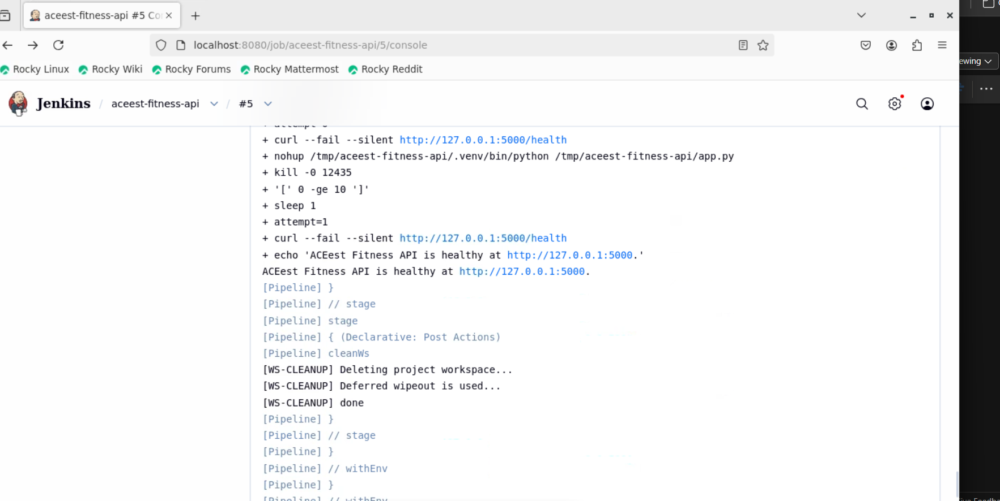
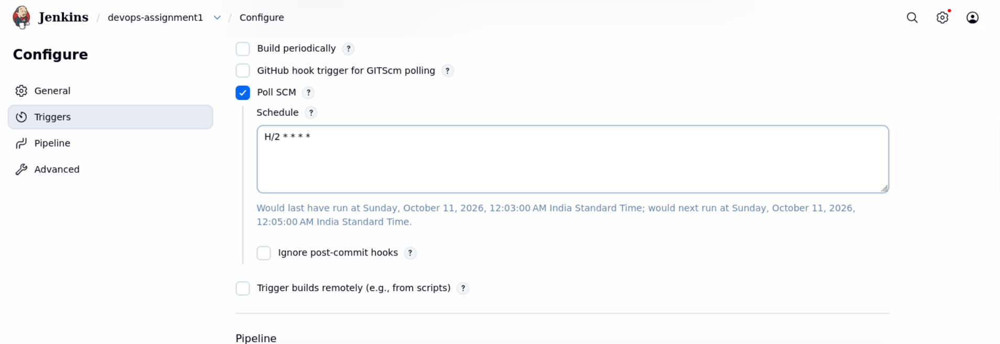
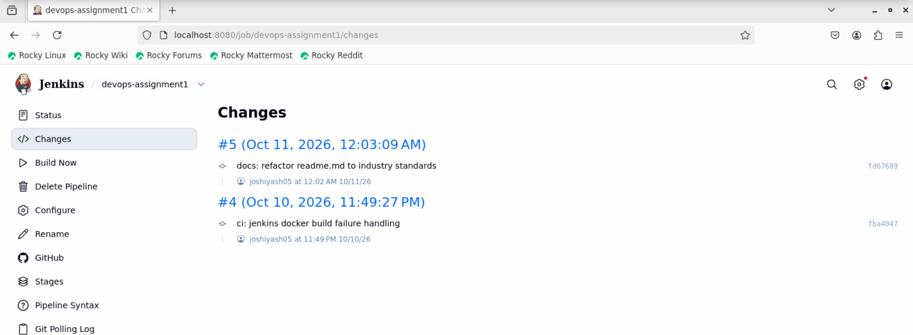

# ACEest Fitness & Gym API

ACEest Fitness & Gym is a small, API-only Flask application built as a DevOps assignment. It provides fitness-program information and lets users manage gym clients and workout logs. The project demonstrates a modular Flask application, automated tests, Docker packaging, and CI with Jenkins and GitHub Actions.

## Contents

- [Features](#features)
- [Project structure](#project-structure)
- [Local setup and execution](#local-setup-and-execution)
- [API overview](#api-overview)
- [Run tests manually](#run-tests-manually)
- [Docker](#docker)
- [CI/CD integrations](#cicd-integrations)

## Features

- JSON REST API for fitness programs, clients, summaries, and workouts.
- SQLite storage initialized automatically when the application starts.
- Interactive Swagger UI and an OpenAPI specification.
- Pytest coverage for API routes and service logic.
- Docker image build and containerized tests in CI.

## Project structure

```text
.
├── aceest/
│   ├── __init__.py       # Flask app factory and application setup
│   ├── openapi.py        # OpenAPI 3.0.3 specification
│   ├── routes.py         # API endpoints
│   ├── services.py       # Fitness calculations and validation
│   └── storage.py        # SQLite data access
├── tests/
│   ├── test_routes.py
│   └── test_services.py
├── .github/workflows/main.yml
├── app.py                # Local and container entry point
├── Dockerfile
├── Jenkinsfile
└── requirements.txt
```

## Local setup and execution

### Prerequisites

- Python 3.12 (used by the GitHub Actions workflow and Docker image)
- Git
- Docker, if you also want to run the container instructions below

### 1. Clone the repository

```bash
git clone https://github.com/joshiyash05/devops-assignment.git
cd devops-assignment
```

### 2. Create and activate a virtual environment

**Windows PowerShell**

```powershell
python -m venv .venv
.\.venv\Scripts\Activate.ps1
```

**macOS / Linux**

```bash
python3 -m venv .venv
source .venv/bin/activate
```

### 3. Install dependencies

```bash
python -m pip install --upgrade pip
python -m pip install -r requirements.txt
```

### 4. Start the API

```bash
python app.py
```

The development server listens on `http://127.0.0.1:5000`. The SQLite database is created automatically at `instance/aceest.sqlite3` on first startup.

Useful URLs:

| Purpose | URL |
| --- | --- |
| API root | <http://127.0.0.1:5000/> |
| Health check | <http://127.0.0.1:5000/health> |
| Swagger UI | <http://127.0.0.1:5000/docs> |
| OpenAPI JSON | <http://127.0.0.1:5000/openapi.json> |

Swagger UI loads its interface assets from `unpkg.com`, so those assets require an internet connection. Open Swagger at `/docs` through the running Flask server rather than opening a local HTML file.

## API overview

All API responses use JSON. Client and workout creation endpoints accept JSON request bodies and return `400` with validation errors for invalid payloads.

| Method | Endpoint | Description |
| --- | --- | --- |
| `GET` | `/health` | Report service health |
| `GET` | `/programs` | List available fitness programs |
| `GET` | `/clients` | List clients |
| `POST` | `/clients` | Create a client |
| `GET` | `/clients/<id>` | Get one client |
| `GET` | `/clients/<id>/summary` | Get a client summary, including BMI and workout count |
| `GET` | `/clients/<id>/workouts` | List a client's workouts |
| `POST` | `/clients/<id>/workouts` | Add a workout for a client |

Example client request:

```json
{
  "name": "Asha Kumar",
  "age": 29,
  "height_cm": 168,
  "weight_kg": 66,
  "program": "Fat Loss",
  "membership_end": "2999-12-31"
}
```

The `program` field may be `Fat Loss`, `Muscle Gain`, or `Beginner`; if omitted, it defaults to `Beginner`. The `membership_end` field is optional and uses `YYYY-MM-DD` format. See Swagger UI for the complete request and response schemas.

## Run tests manually

Activate the virtual environment and install dependencies as described above, then run the test suite from the repository root:

```bash
python -m pytest
```

To run an individual test module:

```bash
python -m pytest tests/test_routes.py
python -m pytest tests/test_services.py
```

The CI pipelines also run a Python bytecode compilation check:

```bash
python -m compileall app.py aceest tests
```

## Docker

Build the image from the repository root:

```bash
docker build -t aceest-fitness-api .
```

Run the API and publish its port:

```bash
docker run --rm -p 5000:5000 aceest-fitness-api
```

The API will then be available at <http://127.0.0.1:5000>. To run the tests inside the image:

```bash
docker run --rm aceest-fitness-api python -m pytest
```

## Kubernetes

The manifests in `k8s/base/` deploy the API to the `aceest` namespace behind a
ClusterIP Service. The Deployment uses Kubernetes rolling updates, HTTP
readiness/liveness probes, and retains five revisions for rollback.

Build and load the image for a local Minikube cluster, then apply the manifests:

```bash
docker build -t aceest-fitness-api:latest .
minikube image load aceest-fitness-api:latest
kubectl apply -f k8s/base/namespace.yaml
kubectl apply -f k8s/base/deployment.yaml -f k8s/base/service.yaml
kubectl -n aceest rollout status deployment/aceest-api
kubectl -n aceest port-forward service/aceest-api 5000:80
```

For a registry-backed cluster, use the versioned Docker Hub image instead of
the local image, for example:

```bash
kubectl -n aceest set image deployment/aceest-api \
  aceest-api=docker.io/<dockerhub-user>/aceest-fitness-api:v1.0.0
kubectl -n aceest rollout status deployment/aceest-api
```

If an update fails, restore the previous Deployment revision:

```bash
kubectl -n aceest rollout undo deployment/aceest-api
kubectl -n aceest rollout status deployment/aceest-api
```

### Advanced deployment strategies

The manifests under `k8s/strategies/` are alternatives to the base Deployment,
not resources to apply together with it. Replace `aceest-fitness-api:latest`
with the intended Docker Hub image in each strategy's workload manifest.

- **Blue-green:** Apply
  `k8s/strategies/blue-green/blue-green.yaml`, set the blue Deployment to the
  current image and the green Deployment to the candidate image, and verify
  green before switching the Service. For example:

  ```bash
  kubectl apply -f k8s/strategies/blue-green/blue-green.yaml
  kubectl -n aceest-bluegreen set image deployment/aceest-api-blue \
    aceest-api=docker.io/<dockerhub-user>/aceest-fitness-api:v1.0.0
  kubectl -n aceest-bluegreen set image deployment/aceest-api-green \
    aceest-api=docker.io/<dockerhub-user>/aceest-fitness-api:v1.1.0
  kubectl -n aceest-bluegreen rollout status deployment/aceest-api-green
  kubectl apply -f k8s/strategies/blue-green/route-green.yaml
  ```

  Roll back traffic immediately with
  `kubectl apply -f k8s/strategies/blue-green/route-blue.yaml`.
- **Canary:** Install Istio and apply
  `k8s/strategies/istio/istio-workloads.yaml`. Set the stable and candidate
  Deployment images and verify both rollouts:

  ```bash
  kubectl -n aceest-istio set image deployment/aceest-api-stable \
    aceest-api=docker.io/<dockerhub-user>/aceest-fitness-api:v1.0.0
  kubectl -n aceest-istio set image deployment/aceest-api-candidate \
    aceest-api=docker.io/<dockerhub-user>/aceest-fitness-api:v1.1.0
  kubectl -n aceest-istio rollout status deployment/aceest-api-stable
  kubectl -n aceest-istio rollout status deployment/aceest-api-candidate
  kubectl apply -f k8s/strategies/istio/route-canary.yaml
  ```

  The canary route sends 10% of traffic to the candidate. Apply
  `k8s/strategies/istio/route-stable.yaml` to roll traffic back to stable.
- **A/B testing:** With the Istio workloads installed and both versions healthy,
  apply `route-ab.yaml`. Requests with `x-experiment: candidate` use the
  candidate; other requests use stable.
- **Shadow:** Apply `route-shadow.yaml` to serve GET requests from stable and
  mirror them to the candidate without returning candidate responses. Only GET
  requests are mirrored, avoiding duplicated writes from this API's POST
  endpoints.

The Docker Hub repository must be public for Kubernetes nodes to pull these
images without additional image-pull credentials. The Istio examples use the
host `aceest-api.example.com`; configure DNS or a local hosts entry to point it
at the Istio ingress gateway. Verify candidate health before switching traffic.
The API currently stores data in a per-container SQLite database; these
manifests are for assignment demonstrations, not durable production storage or
horizontally scaled writes.

## CI/CD integrations

Both CI configurations install the Python dependencies, compile the application and tests, run pytest, build the Docker image, and run pytest again inside the image.

### Jenkins

The root-level `Jenkinsfile` defines a declarative pipeline with these stages:

1. **Checkout** — check out the configured source repository.
2. **Prepare Version** — use the Git `vMAJOR.MINOR.PATCH` tag, or a short commit SHA for untagged builds.
3. **Install Dependencies** and **Build and Lint** — install `requirements.txt` and run `compileall`.
4. **Build Docker Image** and **Containerized Tests** — run pytest inside the built image.
5. **SonarQube Analysis and Quality Gate** — submit the analysis and stop the pipeline if the configured quality gate fails.
6. **Publish to Docker Hub** — push the versioned image after tests and the quality gate pass.
7. **Deploy to Kubernetes** — apply `k8s/base/` to the configured cluster, update the image, and wait for rollout; restore the previous Deployment revision when rollout fails.

The pipeline polls the configured SCM every two minutes (`H/2 * * * *`) and cleans the Jenkins workspace after each run. Configure a Jenkins Pipeline job to use this repository and its `Jenkinsfile`. Its Linux agent requires Python 3, Docker, `kubectl`, and SonarScanner installed at `/opt/sonar-scanner/bin/sonar-scanner`. Install the Jenkins Pipeline, Credentials Binding, and Workspace Cleanup plugins. Add a Jenkins **Secret text** credential with ID `sonar-token` containing your SonarQube user token; the pipeline connects to SonarQube at `http://localhost:9000` and waits for the quality gate in the scanner, so it does not require Jenkins SonarQube server configuration or a webhook. If Jenkins runs in a container, change `localhost` to a hostname/address reachable from that container. Add Jenkins username/password credentials named `dockerhub-credentials` for your Docker Hub account and a secret-file credential named `kubeconfig` containing credentials for the target cluster. The Docker Hub repository name defaults to `aceest-fitness-api`; ensure it exists under the configured Docker Hub username. The Kubernetes deployment uses the `aceest` namespace and the rolling-update base manifests. The API stores data in a per-container SQLite database, so this is suitable for an assignment/demo and not durable production storage or horizontally scaled writes.

Create and push semantic-version release tags to publish images with the same tag. Untagged builds use a unique short-commit image tag:

```bash
git tag -a v1.0.0 -m "Release v1.0.0"
git push origin v1.0.0
```

Use short-lived feature or fix branches and merge tested changes to the release
branch before tagging. Configure Jenkins as a Multibranch Pipeline with tag
discovery enabled, or trigger the tag build explicitly; branch-only SCM polling
may not discover a tag-only update. For example, the Docker Hub images are
tagged `v1.0.0` for that release, and `sha-<commit>` for an untagged build. No
mutable `latest` tag is used for releases.

### GitHub Actions

The workflow at `.github/workflows/main.yml` runs on pushes and pull requests targeting `main` or `master`. It uses an Ubuntu runner with Python 3.12 and performs these steps:

1. Check out the repository.
2. Set up Python and install dependencies.
3. Compile the application and tests.
4. Run the pytest suite.
5. Build the Docker image.
6. Run pytest inside the built image.

The GitHub Actions workflow requires the Docker build and containerized test steps to succeed for the job to pass.

## Jenkins Pipeline Proof

The following screenshots document the Jenkins configuration, pipeline execution, SCM polling, and successful deployment of the ACEest Fitness API.

### Successful deployment



### Pipeline execution


### Pipeline configuration


### SCM polling configuration



### Jenkins changes


