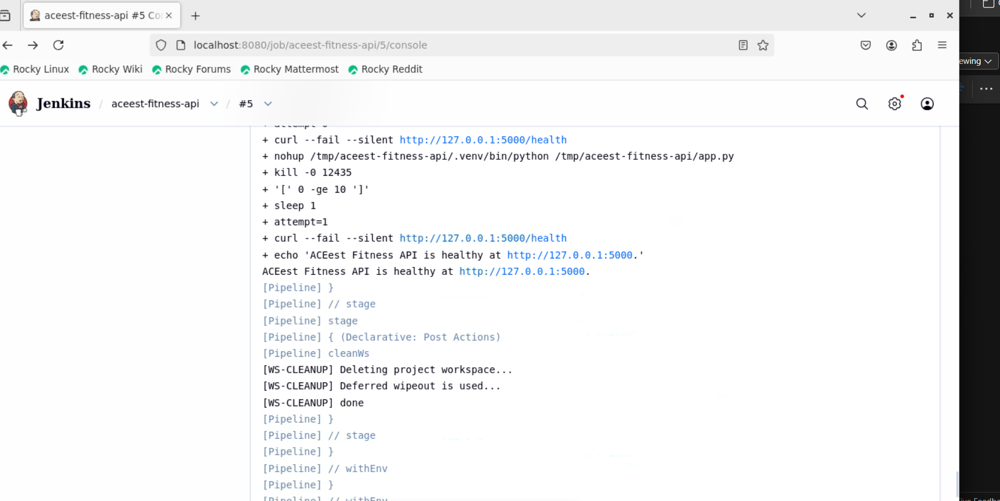
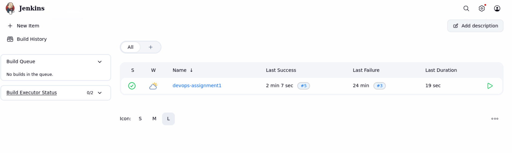
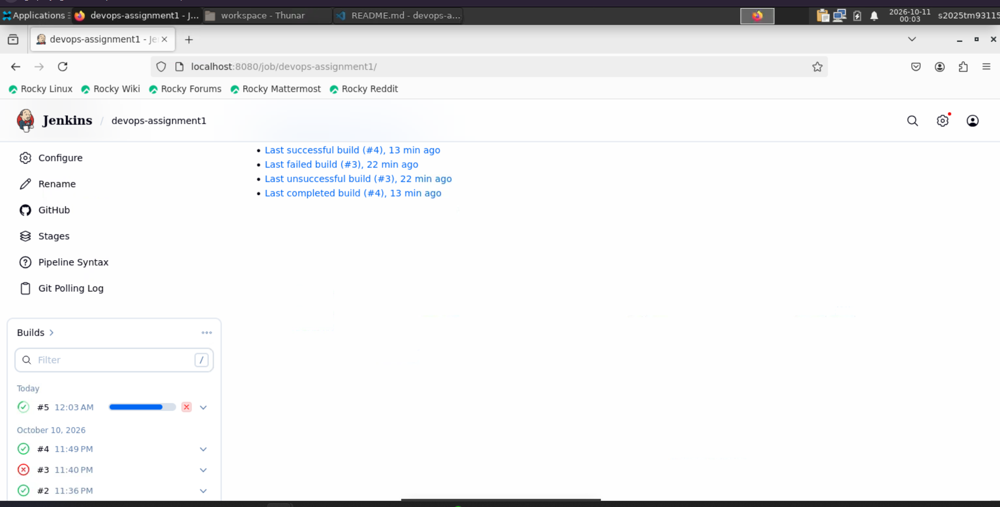
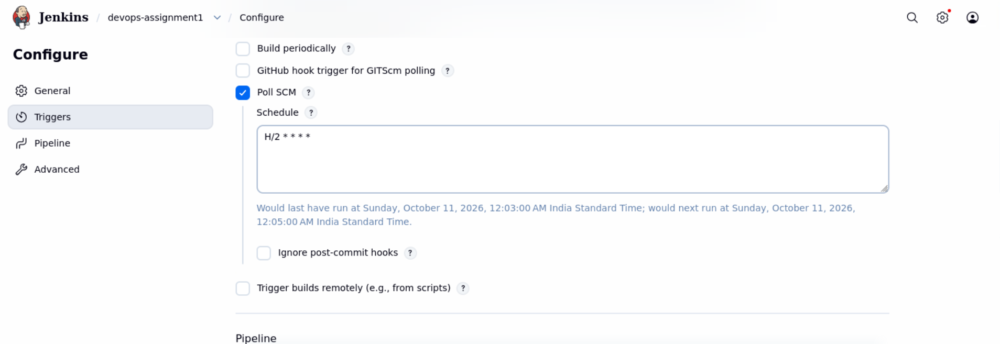
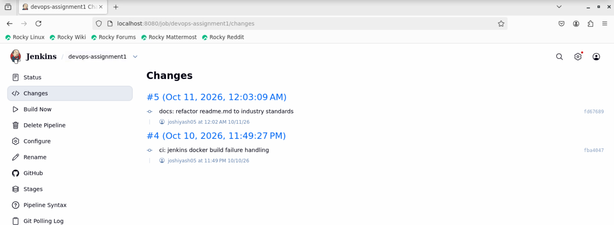

# ACEest Fitness & Gym API

ACEest Fitness & Gym is a small, API-only Flask application built as a DevOps assignment. It provides fitness-program information and lets users manage gym clients and workout logs. The project demonstrates a modular Flask application, automated tests, Docker packaging, and CI with Jenkins and GitHub Actions.

## Contents

- [Features](#features)
- [Project structure](#project-structure)
- [Local setup and execution](#local-setup-and-execution)
- [API overview](#api-overview)
- [Run tests manually](#run-tests-manually)
- [Docker](#docker)
- [CI/CD integrations](#cicd-integrations)

## Features

- JSON REST API for fitness programs, clients, summaries, and workouts.
- SQLite storage initialized automatically when the application starts.
- Interactive Swagger UI and an OpenAPI specification.
- Pytest coverage for API routes and service logic.
- Docker image build and containerized tests in CI.

## Project structure

```text
.
├── aceest/
│   ├── __init__.py       # Flask app factory and application setup
│   ├── openapi.py        # OpenAPI 3.0.3 specification
│   ├── routes.py         # API endpoints
│   ├── services.py       # Fitness calculations and validation
│   └── storage.py        # SQLite data access
├── tests/
│   ├── test_routes.py
│   └── test_services.py
├── .github/workflows/main.yml
├── app.py                # Local and container entry point
├── Dockerfile
├── Jenkinsfile
└── requirements.txt
```

## Local setup and execution

### Prerequisites

- Python 3.12 (used by the GitHub Actions workflow and Docker image)
- Git
- Docker, if you also want to run the container instructions below

### 1. Clone the repository

```bash
git clone https://github.com/joshiyash05/devops-assignment.git
cd devops-assignment
```

### 2. Create and activate a virtual environment

**Windows PowerShell**

```powershell
python -m venv .venv
.\.venv\Scripts\Activate.ps1
```

**macOS / Linux**

```bash
python3 -m venv .venv
source .venv/bin/activate
```

### 3. Install dependencies

```bash
python -m pip install --upgrade pip
python -m pip install -r requirements.txt
```

### 4. Start the API

```bash
python app.py
```

The development server listens on `http://127.0.0.1:5000`. The SQLite database is created automatically at `instance/aceest.sqlite3` on first startup.

Useful URLs:

| Purpose | URL |
| --- | --- |
| API root | <http://127.0.0.1:5000/> |
| Health check | <http://127.0.0.1:5000/health> |
| Swagger UI | <http://127.0.0.1:5000/docs> |
| OpenAPI JSON | <http://127.0.0.1:5000/openapi.json> |

Swagger UI loads its interface assets from `unpkg.com`, so those assets require an internet connection. Open Swagger at `/docs` through the running Flask server rather than opening a local HTML file.

## API overview

All API responses use JSON. Client and workout creation endpoints accept JSON request bodies and return `400` with validation errors for invalid payloads.

| Method | Endpoint | Description |
| --- | --- | --- |
| `GET` | `/health` | Report service health |
| `GET` | `/programs` | List available fitness programs |
| `GET` | `/clients` | List clients |
| `POST` | `/clients` | Create a client |
| `GET` | `/clients/<id>` | Get one client |
| `GET` | `/clients/<id>/summary` | Get a client summary, including BMI and workout count |
| `GET` | `/clients/<id>/workouts` | List a client's workouts |
| `POST` | `/clients/<id>/workouts` | Add a workout for a client |

Example client request:

```json
{
  "name": "Asha Kumar",
  "age": 29,
  "height_cm": 168,
  "weight_kg": 66,
  "program": "Fat Loss",
  "membership_end": "2999-12-31"
}
```

The `program` field may be `Fat Loss`, `Muscle Gain`, or `Beginner`; if omitted, it defaults to `Beginner`. The `membership_end` field is optional and uses `YYYY-MM-DD` format. See Swagger UI for the complete request and response schemas.

## Run tests manually

Activate the virtual environment and install dependencies as described above, then run the test suite from the repository root:

```bash
python -m pytest
```

To run an individual test module:

```bash
python -m pytest tests/test_routes.py
python -m pytest tests/test_services.py
```

The CI pipelines also run a Python bytecode compilation check:

```bash
python -m compileall app.py aceest tests
```

## Docker

Build the image from the repository root:

```bash
docker build -t aceest-fitness-api .
```

Run the API and publish its port:

```bash
docker run --rm -p 5000:5000 aceest-fitness-api
```

The API will then be available at <http://127.0.0.1:5000>. To run the tests inside the image:

```bash
docker run --rm aceest-fitness-api python -m pytest
```

## CI/CD integrations

Both CI configurations install the Python dependencies, compile the application and tests, run pytest, build the Docker image, and run pytest again inside the image. Docker build and containerized test stages in Jenkins are conditional on Docker being accessible to the Jenkins agent.

### Jenkins

The root-level `Jenkinsfile` defines a declarative pipeline with these stages:

1. **Checkout** — check out the configured source repository.
2. **Install Dependencies** — create a virtual environment and install `requirements.txt`.
3. **Build and Lint** — run `compileall` over the application and tests.
4. **Automated Tests** — run `python -m pytest`.
5. **Check Docker Access** — check whether the Jenkins agent can connect to its Docker daemon.
6. **Docker Image Assembly** and **Containerized Tests** — run only when Docker is available.
7. **Code Inspection** — run SonarScanner using the Jenkins `sonar-token` credential.
8. **Deploy** — copy the Flask entry point and `aceest` package to `/tmp/aceest-fitness-api` on the Jenkins agent, install dependencies in an isolated virtual environment, and start the API after stopping its previous managed process.

The pipeline polls the configured SCM every two minutes (`H/2 * * * *`) and cleans the Jenkins workspace after each run. Configure a Jenkins Pipeline job to use this repository and its `Jenkinsfile`. The pipeline uses Unix shell commands, so its agent must provide a compatible shell, Python 3, `venv`, `ps`, and `curl`. To run the Docker stages, install Docker on the agent and grant the Jenkins user access to the Docker daemon. If Docker is unavailable, the Python compilation and test stages still run, while the Docker stages are skipped. The deployment runs on the Jenkins agent, listens on port `5000`, and stores its SQLite database and logs under `/tmp/aceest-fitness-api`; this is suitable for an assignment/demo agent, not a durable production host.

### GitHub Actions

The workflow at `.github/workflows/main.yml` runs on pushes and pull requests targeting `main` or `master`. It uses an Ubuntu runner with Python 3.12 and performs these steps:

1. Check out the repository.
2. Set up Python and install dependencies.
3. Compile the application and tests.
4. Run the pytest suite.
5. Build the Docker image.
6. Run pytest inside the built image.

The GitHub Actions workflow requires the Docker build and containerized test steps to succeed for the job to pass.

## Jenkins Pipeline Proof

The following screenshots document the Jenkins configuration, pipeline execution, SCM polling, and successful deployment of the ACEest Fitness API.

### Successful deployment



### Pipeline execution



### Pipeline configuration



### SCM polling configuration



### Jenkins changes


