# ACEest Fitness & Gym - DevOps CI/CD Assignment

This repository documents the ACEest Fitness & Gym application and its
two-part DevOps assignment. Together, the two parts demonstrate how an
application is built, tested, containerized, and delivered through an
automated CI/CD workflow.

| Assignment part | Focus |
| --- | --- |
| **Assignment 1 — Application foundation** | Flask fitness API, project structure, automated tests, and the original development work. |
| **Assignment 2 — DevOps delivery** | Rocky Linux setup, Jenkins pipeline, Docker Hub, SonarQube quality gate, Minikube/Kubernetes deployment, and deployment strategies. |

Expand an assignment below for its detailed walkthrough. Assignment 1 keeps
the application and original project information; Assignment 2 explains the
infrastructure and CI/CD setup used to deliver it.

<details>
<summary><strong>Assignment 2 — Jenkins CI/CD, Docker Hub, Rocky Linux and Minikube</strong></summary>

This section describes how to prepare a Rocky Linux host for the Assignment 2
pipeline, create the credentials Jenkins expects, connect Jenkins to local
SonarQube and Minikube, and run a deployment. Commands below assume Rocky Linux
9 on an `x86_64` machine and that Jenkins and Minikube run on the same host.
Adjust repository names, usernames, URLs, and paths to your installation.

> **Important:** Docker access gives a user root-equivalent control of the
> machine. A Minikube kubeconfig also grants cluster access. Keep both
> credentials private, do not commit them to Git, and use a dedicated
> assignment/demo machine.

### What the Jenkins pipeline does

After you configure Jenkins and push code to the configured branch, the
pipeline checks out the code, derives an image tag from a release Git tag or
commit SHA, builds the Docker image, runs pytest inside that image, runs
SonarScanner and waits for the quality gate, pushes the image to Docker Hub, and
deploys the image using the base rolling-update manifests in `k8s/base/`.
Blue-green, canary, A/B, and shadow are separate examples in
`k8s/strategies/`; the current Jenkins pipeline does not deploy those strategies
automatically.

### 1. Install Docker on Rocky Linux

Install Docker Engine and start it:

```bash
sudo dnf -y install dnf-plugins-core curl wget git
sudo dnf config-manager --add-repo \
  https://download.docker.com/linux/centos/docker-ce.repo
sudo dnf -y install docker-ce docker-ce-cli containerd.io \
  docker-buildx-plugin docker-compose-plugin
sudo systemctl enable --now docker
sudo systemctl status docker --no-pager
```

Add your Minikube login user and the Jenkins service account to the Docker
group, so both can use the Docker daemon:

```bash
sudo usermod -aG docker "$USER"
sudo usermod -aG docker jenkins
```

Log out and back in for your own group membership to refresh. Restart Jenkins
to refresh its group membership:

```bash
sudo systemctl restart jenkins
```

Verify Docker as your login user:

```bash
docker run --rm hello-world
```

If Jenkins runs in a container rather than as the host service, host group
membership does not automatically give that container Docker access. Configure
its Docker socket access deliberately and use the correct Jenkins agent for
the pipeline.

### 2. Install Minikube and kubectl

Install Minikube's RPM and `kubectl`:

```bash
curl -LO \
  https://storage.googleapis.com/minikube/releases/latest/minikube-latest.x86_64.rpm
sudo rpm -Uvh minikube-latest.x86_64.rpm

KUBECTL_VERSION="$(curl -L -s https://dl.k8s.io/release/stable.txt)"
curl -LO \
  "https://dl.k8s.io/release/${KUBECTL_VERSION}/bin/linux/amd64/kubectl"
sudo install -o root -g root -m 0755 kubectl /usr/local/bin/kubectl
rm -f minikube-latest.x86_64.rpm kubectl

minikube version
kubectl version --client
```

Start Minikube **as your regular login user, not with `sudo`**, using the
Docker driver:

```bash
minikube start --driver=docker
minikube status
kubectl config get-contexts
kubectl get nodes
```

Minikube normally creates the `minikube` kubectl context. Keep the same host
and Minikube profile running while Jenkins deploys. If your machine is low on
resources, start with fewer CPUs/memory appropriate for your host, for example
`minikube start --driver=docker --cpus=2 --memory=3072`.

### 3. Create a Docker Hub repository and access token

The pipeline pushes images to
`<your-dockerhub-username>/aceest-fitness-api:<version>`.

1. Sign in at [Docker Hub](https://hub.docker.com/).
2. Create a repository named **`aceest-fitness-api`** under your Docker Hub
   account. A public repository is the easiest option for Minikube: Kubernetes
   can pull it without a separate image-pull secret.
3. Open your Docker Hub account settings, find **Personal access tokens** (or
   **Security → Personal access tokens**), and choose **Generate new token**.
4. Give it a recognizable name such as `jenkins-devops`. Grant the permissions
   needed to push images (**Read & Write** or the equivalent available in the
   Docker Hub UI), generate the token, and copy it immediately. Treat it like
   a password; Docker Hub may not show it again.
5. In Jenkins, store the Docker Hub username and this token together in one
   **Username with password** credential (steps below). Use your Docker Hub
   username as the username and the access token—not your account password—as
   the password.

If the repository must remain private, configure an image-pull secret in the
`aceest` namespace and attach it to the Deployment's pod spec. The Jenkins
Docker Hub credential is used to push images; it is not automatically
available to Kubernetes pods.

### 4. Make a kubeconfig file for Jenkins

Run these commands as the same regular Linux user that started Minikube. The
`--raw --flatten --minify` options embed the selected context's certificates
and include only the Minikube context, allowing Jenkins to upload one file:

```bash
umask 077
kubectl config view --raw --flatten --minify --context=minikube \
  > "$HOME/jenkins-minikube.kubeconfig"
chmod 600 "$HOME/jenkins-minikube.kubeconfig"
```

Test the exported file before uploading it:

```bash
KUBECONFIG="$HOME/jenkins-minikube.kubeconfig" kubectl get nodes
```

This must list the Minikube node successfully. If it does not, check that
Minikube is running and that `minikube` is the correct context:

```bash
minikube status
kubectl config get-contexts
minikube update-context
```

Regenerate and retest the kubeconfig after correcting the context. Jenkins
uses the file credential as the `KUBECONFIG` environment variable when it runs
`kubectl`.

**Connectivity check:** the Kubernetes API address embedded in the kubeconfig
must be reachable from the Jenkins agent. If Jenkins is a service directly on
the same Rocky Linux host, the Minikube Docker-driver address is usually
reachable from that host. If Jenkins runs in a container or on a different
machine, do not assume `localhost` or the Minikube address works from there:
the agent needs network access to the API server. Test `kubectl get nodes`
from the Jenkins agent using this credential before relying on deployments.
Do not expose the Kubernetes API publicly just to make Jenkins connect.

### 5. Add credentials in Jenkins

Open Jenkins in a browser and sign in with an administrator account. Go to
**Manage Jenkins → Credentials → System → Global credentials (unrestricted)
→ Add Credentials**. Depending on your Jenkins version, the labels may be
slightly different; add each credential to the global/system store so the
Pipeline job can use it.

Create these three separate credentials. The credential IDs are case-sensitive
and must match the Jenkinsfile:

| ID | Kind in Jenkins | Values to enter |
| --- | --- | --- |
| `dockerhub-credentials` | **Username with password** | Username: Docker Hub username. Password: Docker Hub personal access token. |
| `sonar-token` | **Secret text** | Secret: SonarQube user token. |
| `kubeconfig` | **Secret file** | Upload `jenkins-minikube.kubeconfig` created above. |

#### Docker Hub credential: `dockerhub-credentials`

1. Select **Add Credentials**.
2. For **Kind**, select **Username with password**.
3. Enter your Docker Hub username in **Username**.
4. Paste the Docker Hub personal access token in **Password**. Do not use
   your normal Docker Hub account password.
5. Set **ID** to exactly `dockerhub-credentials`.
6. Optionally enter a description such as `Docker Hub image publishing`.
7. Leave the domain as **Global** (or the default global domain), then click
   **Create**.

This is one Jenkins credential containing a username and password/token pair,
not two separate credentials.

#### SonarQube credential: `sonar-token`

1. Choose **Add Credentials** again.
2. For **Kind**, select **Secret text**.
3. Paste your SonarQube user token into **Secret**.
4. Set **ID** to exactly `sonar-token`.
5. Optionally add a description, then click **Create**.

The current Jenkinsfile connects SonarScanner to
`http://localhost:9000`, uses this token, and asks the scanner to wait for the
quality gate. If SonarQube is not reachable at that address from the agent
running the scanner, update `sonar.host.url` in the Jenkinsfile to an address
that is reachable from that agent. This token-based flow does not use a
Jenkins SonarQube server entry or Jenkins webhook.

To create the token in your local SonarQube UI, sign in, open your user
profile/account menu, go to **My Account → Security**, create a user token
(for example, `jenkins-devops`), and copy it when SonarQube displays it. The
exact menu wording can vary slightly by SonarQube version. Store the token as
the `sonar-token` Secret text credential; do not put it in this README or
`sonar-project.properties`.

#### Minikube credential: `kubeconfig`

1. Choose **Add Credentials** again.
2. For **Kind**, select **Secret file**.
3. Click **Choose File** and select
   `jenkins-minikube.kubeconfig` from the machine where the file was created.
4. Set **ID** to exactly `kubeconfig`.
5. Optionally add a description such as `Minikube deployment kubeconfig`, then
   click **Create**.

Do not paste the kubeconfig contents into the repository, Jenkinsfile, or a
public issue. Keep the local file protected; after Jenkins has stored and
verified it, remove local copies only if you have a secure recovery process.

### 6. Install Jenkins plugins and prepare the agent

The Jenkins agent that runs this Pipeline needs these commands available:

- `python3` and Python virtual-environment support
- `docker`, with permission to access the Docker daemon
- `kubectl`
- `sonar-scanner` installed at
  `/opt/sonar-scanner/bin/sonar-scanner` (that path is added by the Jenkinsfile)
- `git` and a compatible Linux shell

Install/enable the Jenkins **Pipeline**, **Credentials Binding**, and
**Workspace Cleanup** plugins. No Jenkins SonarQube server configuration or
SonarQube webhook is needed for the current `sonar-token` scanner-wait flow.
Make sure your local SonarQube server is up and the quality gate is configured
there.

If the tools were installed only for your interactive user, Jenkins may not
find them. Check from the Jenkins agent/account that `docker`, `kubectl`,
`python3`, and `/opt/sonar-scanner/bin/sonar-scanner` are executable and that
Jenkins can reach both SonarQube and the Minikube Kubernetes API.

### 7. Create and run the Jenkins Pipeline job

1. In Jenkins, choose **New Item**.
2. Enter a job name, select **Pipeline**, and click **OK**.
3. In the job configuration, find **Pipeline**.
4. Set **Definition** to **Pipeline script from SCM**.
5. Set **SCM** to **Git** and enter the repository URL, for example
   `https://github.com/joshiyash05/devops-assignment.git`.
6. Set **Branch Specifier** to your branch, commonly `*/main`. If the
   repository is private, select a Jenkins Git credential with repository
   read access.
7. Set **Script Path** to `Jenkinsfile`.
8. Save, then choose **Build Now** for the first run. Open **Console Output**
   to see which stage succeeds or fails.

The Jenkinsfile polls SCM every two minutes. For release builds, the checked
out commit must have an exact semantic version tag such as `v1.0.0`; an
untagged commit receives a `sha-<commit>` image tag. Regular branch jobs may
not discover a newly pushed Git tag automatically. Configure a Multibranch
Pipeline with tag discovery or trigger the tag build explicitly.

### 8. Verify the pipeline and deployment

When a build succeeds:

```bash
docker pull <your-dockerhub-username>/aceest-fitness-api:<image-tag>
kubectl --kubeconfig="$HOME/jenkins-minikube.kubeconfig" \
  -n aceest get deployments,services,pods
kubectl --kubeconfig="$HOME/jenkins-minikube.kubeconfig" \
  -n aceest rollout status deployment/aceest-api
```

To access the API from the Rocky Linux host:

```bash
kubectl --kubeconfig="$HOME/jenkins-minikube.kubeconfig" \
  -n aceest port-forward service/aceest-api 5000:80
```

In another terminal, check the health endpoint:

```bash
curl --fail http://127.0.0.1:5000/health
```

If a rollout fails, Jenkins attempts to undo it. You can also restore the
previous Deployment revision manually:

```bash
kubectl --kubeconfig="$HOME/jenkins-minikube.kubeconfig" \
  -n aceest rollout undo deployment/aceest-api
kubectl --kubeconfig="$HOME/jenkins-minikube.kubeconfig" \
  -n aceest rollout status deployment/aceest-api
```

### Assignment 2 screenshots

These screenshots show the Jenkins pipeline, Docker Hub image publishing,
SonarQube quality gate, Jenkins credentials, and successful Minikube rollout.
The browser/session bar has been redacted in these copies before adding them
to the README.

#### Jenkins pipeline and Docker

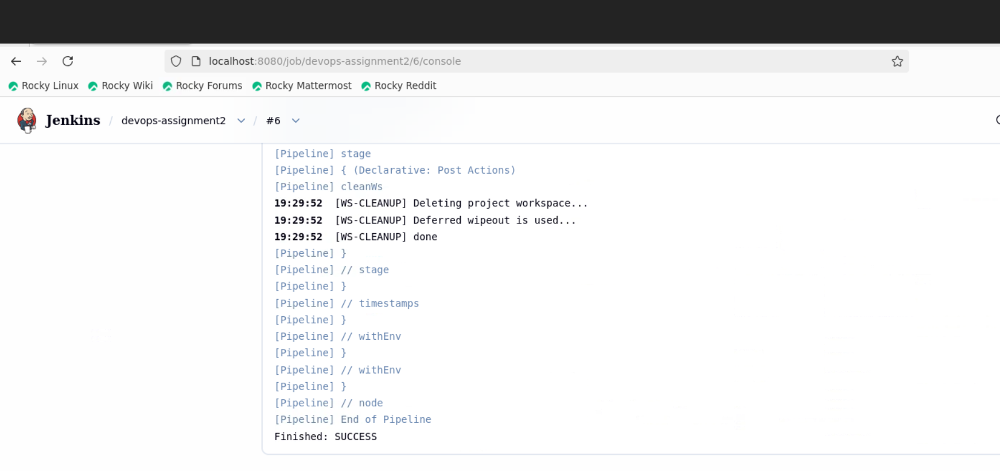

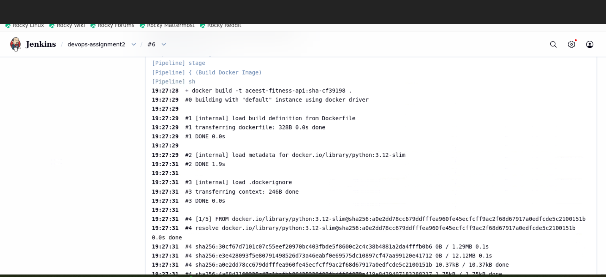

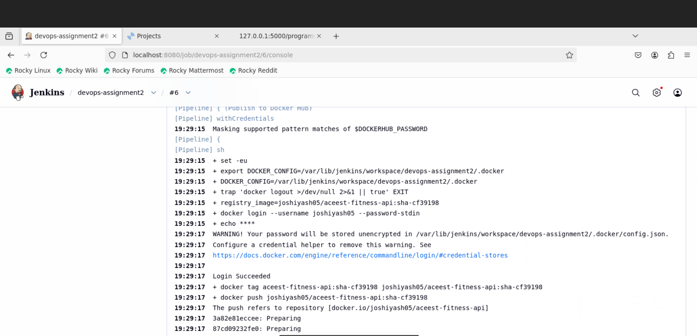

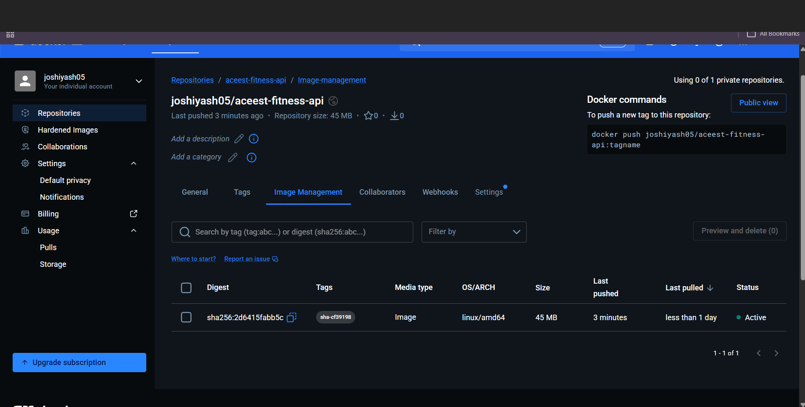

#### SonarQube quality gate

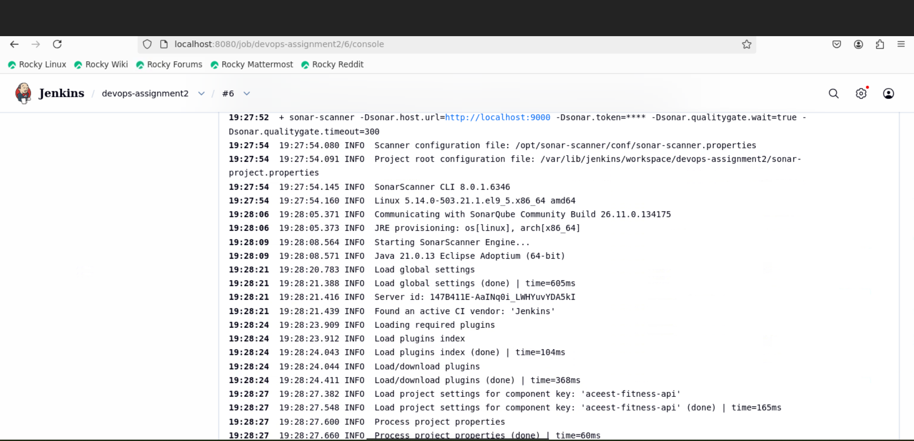

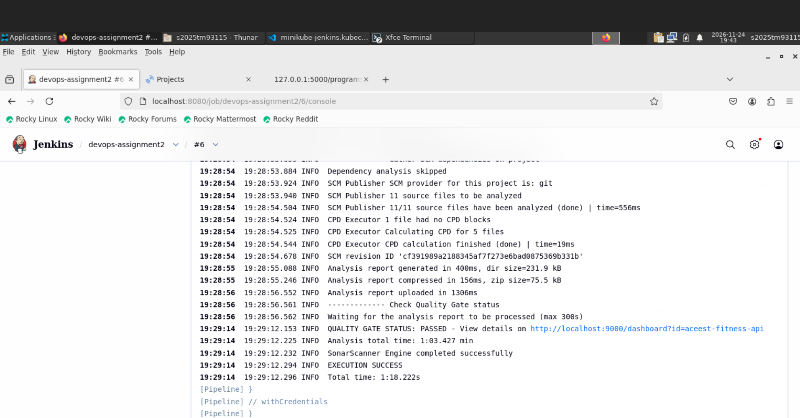

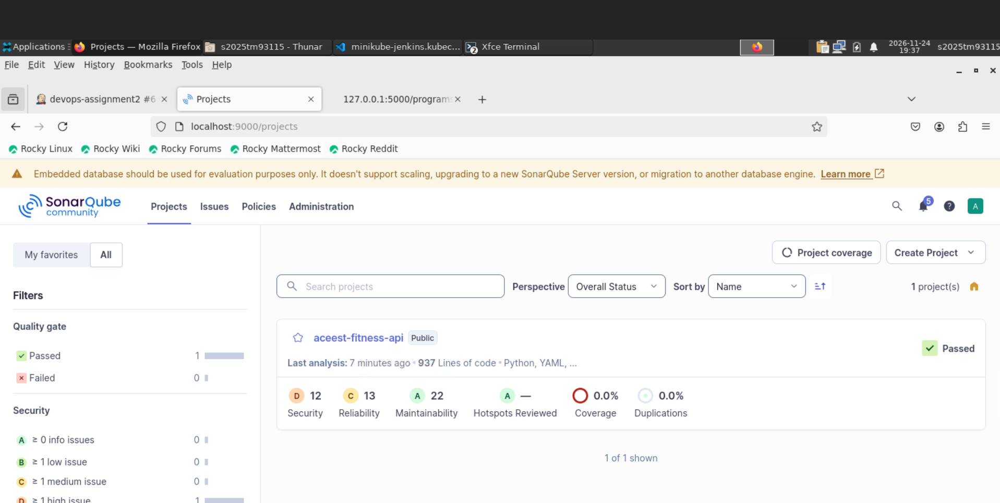

#### Jenkins credentials and Minikube deployment

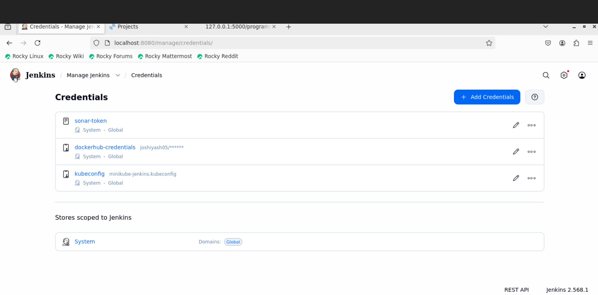

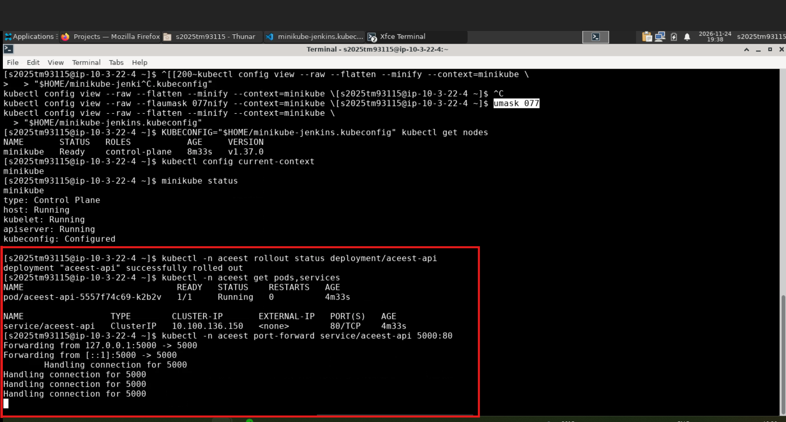

</details>

<details>
<summary><strong>Assignment 1 — ACEest Fitness &amp; Gym API</strong></summary>

## ACEest Fitness & Gym API

ACEest Fitness & Gym is a small, API-only Flask application built as a DevOps assignment. It provides fitness-program information and lets users manage gym clients and workout logs. The project demonstrates a modular Flask application, automated tests, Docker packaging, and CI with Jenkins and GitHub Actions.

## Contents

- [Features](#features)
- [Project structure](#project-structure)
- [Local setup and execution](#local-setup-and-execution)
- [API overview](#api-overview)
- [Run tests manually](#run-tests-manually)
- [Docker](#docker)
- [CI/CD integrations](#cicd-integrations)

## Features

- JSON REST API for fitness programs, clients, summaries, and workouts.
- SQLite storage initialized automatically when the application starts.
- Interactive Swagger UI and an OpenAPI specification.
- Pytest coverage for API routes and service logic.
- Docker image build and containerized tests in CI.

## Project structure

```text
.
├── aceest/
│   ├── __init__.py       # Flask app factory and application setup
│   ├── openapi.py        # OpenAPI 3.0.3 specification
│   ├── routes.py         # API endpoints
│   ├── services.py       # Fitness calculations and validation
│   └── storage.py        # SQLite data access
├── tests/
│   ├── test_routes.py
│   └── test_services.py
├── .github/workflows/main.yml
├── app.py                # Local and container entry point
├── Dockerfile
├── Jenkinsfile
└── requirements.txt
```

## Local setup and execution

### Prerequisites

- Python 3.12 (used by the GitHub Actions workflow and Docker image)
- Git
- Docker, if you also want to run the container instructions below

### 1. Clone the repository

```bash
git clone https://github.com/joshiyash05/devops-assignment.git
cd devops-assignment
```

### 2. Create and activate a virtual environment

**Windows PowerShell**

```powershell
python -m venv .venv
.\.venv\Scripts\Activate.ps1
```

**macOS / Linux**

```bash
python3 -m venv .venv
source .venv/bin/activate
```

### 3. Install dependencies

```bash
python -m pip install --upgrade pip
python -m pip install -r requirements.txt
```

### 4. Start the API

```bash
python app.py
```

The development server listens on `http://127.0.0.1:5000`. The SQLite database is created automatically at `instance/aceest.sqlite3` on first startup.

Useful URLs:

| Purpose | URL |
| --- | --- |
| API root | <http://127.0.0.1:5000/> |
| Health check | <http://127.0.0.1:5000/health> |
| Swagger UI | <http://127.0.0.1:5000/docs> |
| OpenAPI JSON | <http://127.0.0.1:5000/openapi.json> |

Swagger UI loads its interface assets from `unpkg.com`, so those assets require an internet connection. Open Swagger at `/docs` through the running Flask server rather than opening a local HTML file.

## API overview

All API responses use JSON. Client and workout creation endpoints accept JSON request bodies and return `400` with validation errors for invalid payloads.

| Method | Endpoint | Description |
| --- | --- | --- |
| `GET` | `/health` | Report service health |
| `GET` | `/programs` | List available fitness programs |
| `GET` | `/clients` | List clients |
| `POST` | `/clients` | Create a client |
| `GET` | `/clients/<id>` | Get one client |
| `GET` | `/clients/<id>/summary` | Get a client summary, including BMI and workout count |
| `GET` | `/clients/<id>/workouts` | List a client's workouts |
| `POST` | `/clients/<id>/workouts` | Add a workout for a client |

Example client request:

```json
{
  "name": "Asha Kumar",
  "age": 29,
  "height_cm": 168,
  "weight_kg": 66,
  "program": "Fat Loss",
  "membership_end": "2999-12-31"
}
```

The `program` field may be `Fat Loss`, `Muscle Gain`, or `Beginner`; if omitted, it defaults to `Beginner`. The `membership_end` field is optional and uses `YYYY-MM-DD` format. See Swagger UI for the complete request and response schemas.

## Run tests manually

Activate the virtual environment and install dependencies as described above, then run the test suite from the repository root:

```bash
python -m pytest
```

To run an individual test module:

```bash
python -m pytest tests/test_routes.py
python -m pytest tests/test_services.py
```

The CI pipelines also run a Python bytecode compilation check:

```bash
python -m compileall app.py aceest tests
```

## Docker

Build the image from the repository root:

```bash
docker build -t aceest-fitness-api .
```

Run the API and publish its port:

```bash
docker run --rm -p 5000:5000 aceest-fitness-api
```

The API will then be available at <http://127.0.0.1:5000>. To run the tests inside the image:

```bash
docker run --rm aceest-fitness-api python -m pytest
```

## Kubernetes

The manifests in `k8s/base/` deploy the API to the `aceest` namespace behind a
ClusterIP Service. The Deployment uses Kubernetes rolling updates, HTTP
readiness/liveness probes, and retains five revisions for rollback.

Build and load the image for a local Minikube cluster, then apply the manifests:

```bash
docker build -t aceest-fitness-api:latest .
minikube image load aceest-fitness-api:latest
kubectl apply -f k8s/base/namespace.yaml
kubectl apply -f k8s/base/deployment.yaml -f k8s/base/service.yaml
kubectl -n aceest rollout status deployment/aceest-api
kubectl -n aceest port-forward service/aceest-api 5000:80
```

For a registry-backed cluster, use the versioned Docker Hub image instead of
the local image, for example:

```bash
kubectl -n aceest set image deployment/aceest-api \
  aceest-api=docker.io/<dockerhub-user>/aceest-fitness-api:v1.0.0
kubectl -n aceest rollout status deployment/aceest-api
```

If an update fails, restore the previous Deployment revision:

```bash
kubectl -n aceest rollout undo deployment/aceest-api
kubectl -n aceest rollout status deployment/aceest-api
```

### Advanced deployment strategies

The manifests under `k8s/strategies/` are alternatives to the base Deployment,
not resources to apply together with it. Replace `aceest-fitness-api:latest`
with the intended Docker Hub image in each strategy's workload manifest.

- **Blue-green:** Apply
  `k8s/strategies/blue-green/blue-green.yaml`, set the blue Deployment to the
  current image and the green Deployment to the candidate image, and verify
  green before switching the Service. For example:

  ```bash
  kubectl apply -f k8s/strategies/blue-green/blue-green.yaml
  kubectl -n aceest-bluegreen set image deployment/aceest-api-blue \
    aceest-api=docker.io/<dockerhub-user>/aceest-fitness-api:v1.0.0
  kubectl -n aceest-bluegreen set image deployment/aceest-api-green \
    aceest-api=docker.io/<dockerhub-user>/aceest-fitness-api:v1.1.0
  kubectl -n aceest-bluegreen rollout status deployment/aceest-api-green
  kubectl apply -f k8s/strategies/blue-green/route-green.yaml
  ```

  Roll back traffic immediately with
  `kubectl apply -f k8s/strategies/blue-green/route-blue.yaml`.
- **Canary:** Install Istio and apply
  `k8s/strategies/istio/istio-workloads.yaml`. Set the stable and candidate
  Deployment images and verify both rollouts:

  ```bash
  kubectl -n aceest-istio set image deployment/aceest-api-stable \
    aceest-api=docker.io/<dockerhub-user>/aceest-fitness-api:v1.0.0
  kubectl -n aceest-istio set image deployment/aceest-api-candidate \
    aceest-api=docker.io/<dockerhub-user>/aceest-fitness-api:v1.1.0
  kubectl -n aceest-istio rollout status deployment/aceest-api-stable
  kubectl -n aceest-istio rollout status deployment/aceest-api-candidate
  kubectl apply -f k8s/strategies/istio/route-canary.yaml
  ```

  The canary route sends 10% of traffic to the candidate. Apply
  `k8s/strategies/istio/route-stable.yaml` to roll traffic back to stable.
- **A/B testing:** With the Istio workloads installed and both versions healthy,
  apply `route-ab.yaml`. Requests with `x-experiment: candidate` use the
  candidate; other requests use stable.
- **Shadow:** Apply `route-shadow.yaml` to serve GET requests from stable and
  mirror them to the candidate without returning candidate responses. Only GET
  requests are mirrored, avoiding duplicated writes from this API's POST
  endpoints.

The Docker Hub repository must be public for Kubernetes nodes to pull these
images without additional image-pull credentials. The Istio examples use the
host `aceest-api.example.com`; configure DNS or a local hosts entry to point it
at the Istio ingress gateway. Verify candidate health before switching traffic.
The API currently stores data in a per-container SQLite database; these
manifests are for assignment demonstrations, not durable production storage or
horizontally scaled writes.

## CI/CD integrations

Both CI configurations install the Python dependencies, compile the application and tests, run pytest, build the Docker image, and run pytest again inside the image.

### Jenkins

The root-level `Jenkinsfile` defines a declarative pipeline with these stages:

1. **Checkout** — check out the configured source repository.
2. **Prepare Version** — use the Git `vMAJOR.MINOR.PATCH` tag, or a short commit SHA for untagged builds.
3. **Install Dependencies** and **Build and Lint** — install `requirements.txt` and run `compileall`.
4. **Build Docker Image** and **Containerized Tests** — run pytest inside the built image.
5. **SonarQube Analysis and Quality Gate** — submit the analysis and stop the pipeline if the configured quality gate fails.
6. **Publish to Docker Hub** — push the versioned image after tests and the quality gate pass.
7. **Deploy to Kubernetes** — apply `k8s/base/` to the configured cluster, update the image, and wait for rollout; restore the previous Deployment revision when rollout fails.

The pipeline polls the configured SCM every two minutes (`H/2 * * * *`) and cleans the Jenkins workspace after each run. Configure a Jenkins Pipeline job to use this repository and its `Jenkinsfile`. Its Linux agent requires Python 3, Docker, `kubectl`, and SonarScanner installed at `/opt/sonar-scanner/bin/sonar-scanner`. Install the Jenkins Pipeline, Credentials Binding, and Workspace Cleanup plugins. Add a Jenkins **Secret text** credential with ID `sonar-token` containing your SonarQube user token; the pipeline connects to SonarQube at `http://localhost:9000` and waits for the quality gate in the scanner, so it does not require Jenkins SonarQube server configuration or a webhook. If Jenkins runs in a container, change `localhost` to a hostname/address reachable from that container. Add Jenkins username/password credentials named `dockerhub-credentials` for your Docker Hub account and a secret-file credential named `kubeconfig` containing credentials for the target cluster. The Docker Hub repository name defaults to `aceest-fitness-api`; ensure it exists under the configured Docker Hub username. The Kubernetes deployment uses the `aceest` namespace and the rolling-update base manifests. The API stores data in a per-container SQLite database, so this is suitable for an assignment/demo and not durable production storage or horizontally scaled writes.

Create and push semantic-version release tags to publish images with the same tag. Untagged builds use a unique short-commit image tag:

```bash
git tag -a v1.0.0 -m "Release v1.0.0"
git push origin v1.0.0
```

Use short-lived feature or fix branches and merge tested changes to the release
branch before tagging. Configure Jenkins as a Multibranch Pipeline with tag
discovery enabled, or trigger the tag build explicitly; branch-only SCM polling
may not discover a tag-only update. For example, the Docker Hub images are
tagged `v1.0.0` for that release, and `sha-<commit>` for an untagged build. No
mutable `latest` tag is used for releases.

### GitHub Actions

The workflow at `.github/workflows/main.yml` runs on pushes and pull requests targeting `main` or `master`. It uses an Ubuntu runner with Python 3.12 and performs these steps:

1. Check out the repository.
2. Set up Python and install dependencies.
3. Compile the application and tests.
4. Run the pytest suite.
5. Build the Docker image.
6. Run pytest inside the built image.

The GitHub Actions workflow requires the Docker build and containerized test steps to succeed for the job to pass.

## Jenkins Pipeline Proof

The following screenshots document the Jenkins configuration, pipeline execution, SCM polling, and successful deployment of the ACEest Fitness API.

### Successful deployment


### Pipeline execution

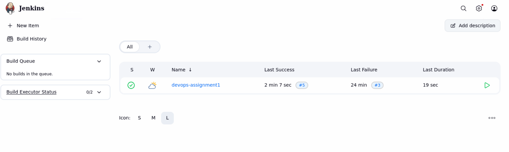

### Pipeline configuration

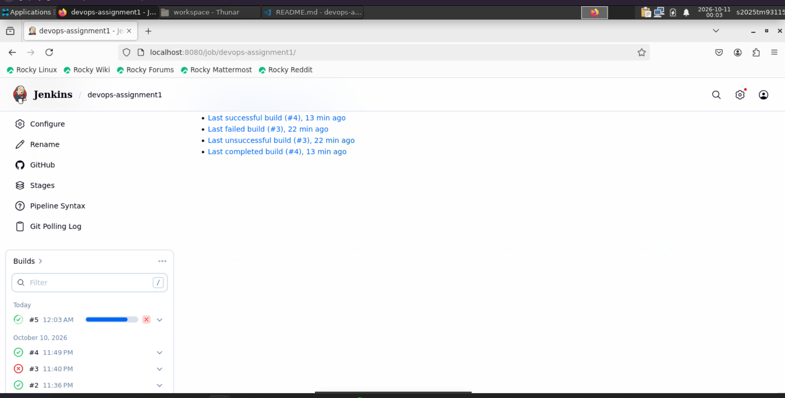

### SCM polling configuration


### Jenkins changes


</details>
